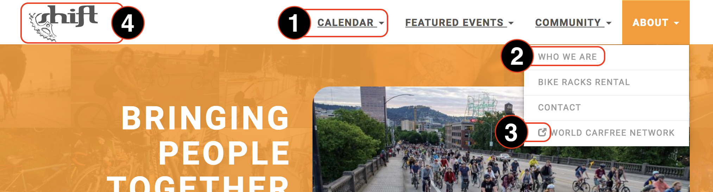

# Understanding the site

The site is built with [Hugo](https://gohugo.io/), using a theme that started out as a port of the [Universal](https://themes.gohugo.io/hugo-universal-theme/) theme. All of the edits related to the theme and its content are done in **shift-docs/site**. see `site/README` for more info.

#### Definition of terms used in this document
1. navbar items
2. children of navbar items
3. External link icon (no longer used; the menu has no off-site links right now)
4. home logo



## Navbar items & children

The navbar is Hugo's `main` menu, drawn by `site/themes/s2b_hugo_theme/layouts/partials/nav.html`. Entries come from two places:

- `site/config/_default/hugo.toml`: each `[[menu.main]]` block is one entry. The four navbar items (Calendar, Featured Events, Community, About) are defined here, along with a few children like the calendar links.
- page frontmatter: most children are pages that add themselves with a `menu` block. See [Adding content to the site navigation](UPDATING.md#adding-content-to-the-site-navigation) for how.

A child's `parent` has to match the `identifier` of a navbar item: `featuredevents`, `communitynav` or `aboutmenu`. Calendar doesn't set an identifier, so its children use its name instead (`parent: Calendar`).

The text shown in the menu is the page `title`, unless the menu block sets a `name`. The order within a dropdown comes from the page `weight`, lowest first.

## Page missing from the menu?

Look for a warning like this in the hugo output:

```
WARN  "site/content/pages/pedalpalooza.md:1:1": duplicate menu entry with identifier "Pedalpalooza" in menu "main"
```

If an entry doesn't set an `identifier`, hugo uses its name. So two entries with the same name collide, even if the pages are in different directories, or one of them is in `hugo.toml`. Hugo keeps one and quietly drops the other. The build still works, so the warning is the only clue. (Older versions of hugo stopped the build with an error instead.)

To fix it, give the page its own `identifier`:

```
menu:
    main:
        parent: aboutmenu
        identifier: about-calendar
```

or change its `title` or menu `name` so they don't match.
